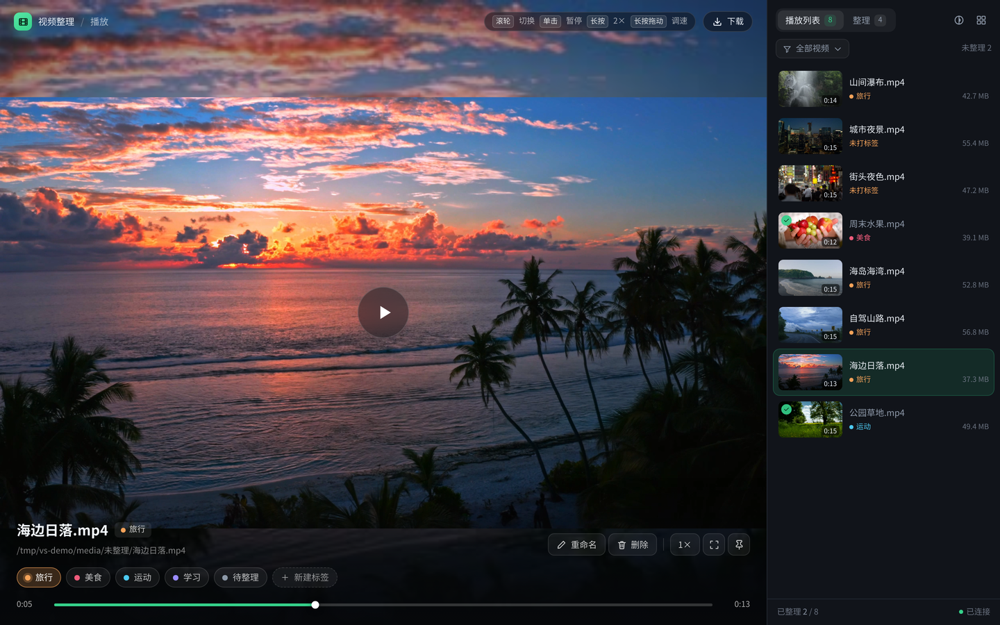
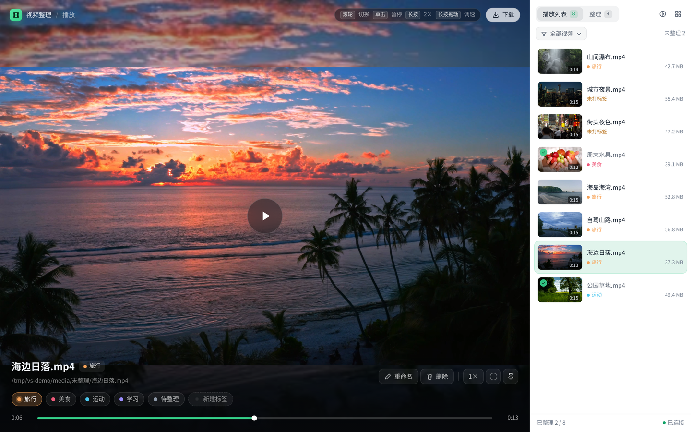
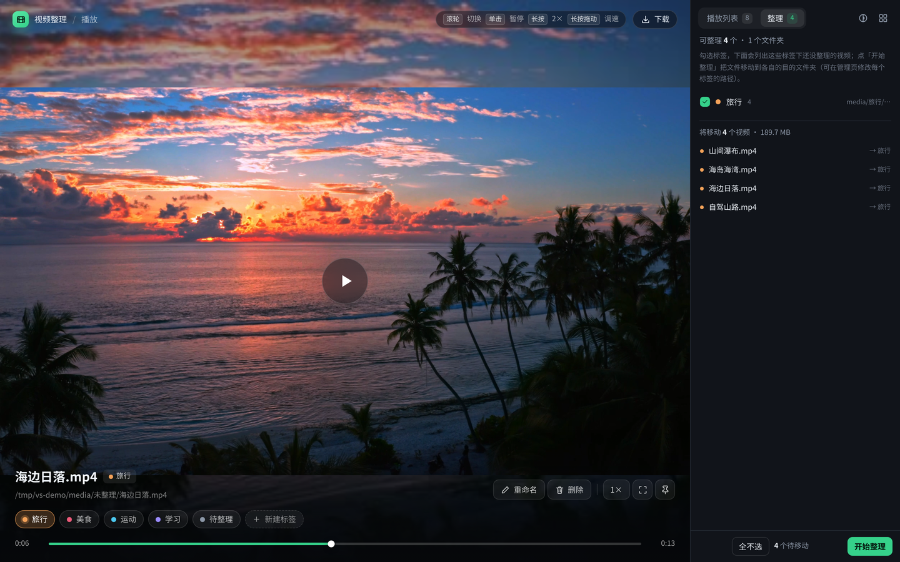
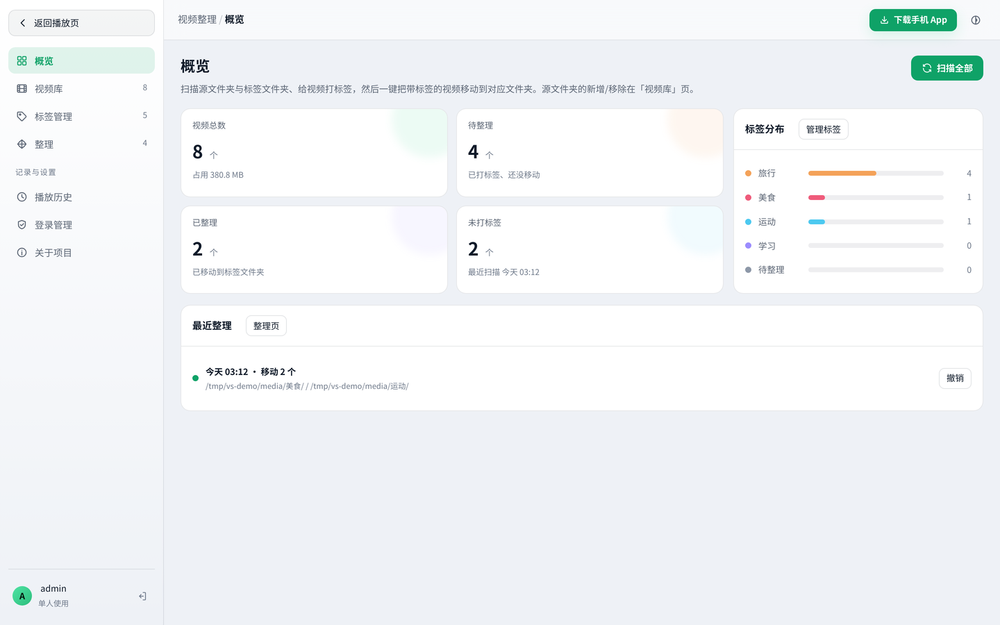
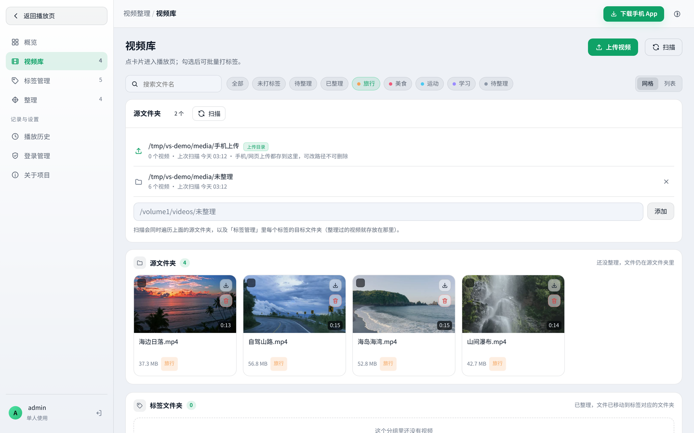
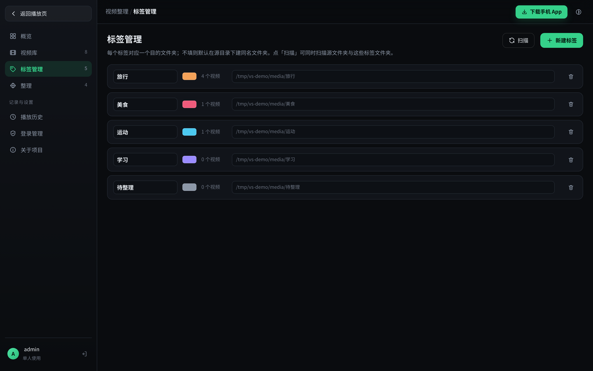

# 视频整理 · VideoSorter

[](https://github.com/mdjbn/video-sorter/actions/workflows/backend.yml)
[](https://github.com/mdjbn/video-sorter/actions/workflows/e2e.yml)
[](https://github.com/mdjbn/video-sorter/releases)
[](LICENSE)

自托管的「扫描 → 观看打标签 → 按标签自动归档」视频整理工具。
一套 Python 后端同时给网页端、手机端、Windows 桌面端用；数据全部在本地，不依赖任何云服务。

```
源文件夹里的视频  →  播放页边看边打标签  →  点「整理」 →  文件移动到「标签文件夹」
```

## 下载 / 安装

安装包都在 [Releases](https://github.com/mdjbn/video-sorter/releases) 里，按你的设备挑：

| 你要装的 | 下载文件 | 说明 |
| --- | --- | --- |
| fnOS / Linux / Windows 服务器 | `run.sh`（源码运行）或 `videosorter.fpk`（fnOS 应用中心） | 一个后端给三端用；fpk 装完在应用中心点开即可 |
| Windows 单机使用 | `VideoSorter_*_x64-setup.exe`（NSIS）或 `.msi` | 内嵌 Python 服务与网页端，双击即用 |
| Windows 免安装 | `VideoSorter-portable.zip` | 解压后双击 `启动.bat` |
| 安卓手机 | `app-debug.apk` | 自签名 debug 包，需要允许「安装未知应用」 |

> 手机端连接同一台服务器：打开 App →「扫描局域网」或手填 `http://<服务器IP>:8080` → 登录
> （默认 `admin` / `admin1234`，登录管理里可改）。

## 功能

- **扫描**：多个源文件夹、递归扫描 20+ 种视频格式，自动用 ffmpeg 抽封面、读时长/分辨率/编码，按 mtime+size 增量更新。
- **播放页（主页面）**：登录后直接进入；滚轮/上下滑切换视频，单击暂停，长按 2× 加速，长按左右拖动调速，进度条可拖，自动记录播放进度（下次接着看）。侧栏两个页签：**播放列表**（搜索/筛选/标签）+ **整理**（勾选标签，预览要移动的文件，一键整理）。
- **标签**：默认 5 个（旅行/美食/运动/学习/待整理），可增删改、改颜色、给每个标签指定绝对目的文件夹。
- **整理**：按标签移动到对应文件夹；重名自动加 ` (1)`；跨盘自动「复制→校验→删除」；整批记录可**撤销**；单文件失败不中断整批。
- **管理页**：概览（统计/源文件夹/扫描/标签分布/最近整理）、视频库（筛选/搜索/批量打标签）、标签管理、整理（预览+执行+记录+撤销）、播放历史、登录管理（改用户名/密码、登录会话）、关于。
- **三档主题**：深色 / 浅色 / 跟随系统，网页端和手机端共用同一份偏好键 `vs-theme`。
- **播放兼容**：MP4/MOV/WebM（H.264 + AAC）直接 `<video>` 播放并支持 Range 拖拽；其它（MKV/AVI/HEVC…）自动用 ffmpeg 切成 HLS 边转边播。

## 快速开始

### 环境要求

| 组件 | 版本 | 说明 |
| --- | --- | --- |
| Python | 3.10+ | 后端，仅标准库 + fastapi/uvicorn |
| Node.js | 18+ | 只在构建网页端时需要 |
| ffmpeg / ffprobe | 4.0+ | 抽封面 + 转码 + 时长探测（也可放进 `server/tools/`） |

### 启动（Linux / macOS / fnOS）

```bash
chmod +x run.sh          # 拷贝到服务器后常见 Permission denied，先给执行权限
./run.sh                 # 首次会自动建 venv、装依赖、构建网页端
./run.sh --port 8080     # 自定义端口
```

打开 `http://<服务器IP>:8080`，默认账号 **admin / admin1234**（登录后请在「登录管理」里改掉）。

### 启动（Windows）

```bat
run.bat
```

或者手动：

```bash
cd server
python -m venv .venv && .venv\Scripts\pip install -r requirements.txt
.venv\Scripts\python -m videosorter --web-dir ..\web\dist
```

### 使用流程

1. 管理页 →「概览」→ 添加源文件夹（例如 `/volume1/videos/未整理`）→ 点「扫描源文件夹」。
2. 回到播放页，挑视频看，点底部标签（点「＋ 新建标签」可当场建）。
3. 侧栏切到「整理」→ 取消不想动的标签 → 点「开始整理」。
4. 文件会移动到标签对应文件夹；要反悔就在「整理记录」里撤销。

## 装成 fnOS 应用（.fpk）

打包脚本会把后端、网页端和运行时依赖一起塞进 fnOS 应用包，装完在桌面上就是一个图标，
不用开终端、不用 Docker、不用手动建 venv。

```bash
bash packaging/fnos/build.sh
# 产物：dist/fnos/videosorter.fpk（约 3.5 MB）
```

安装：fnOS「应用中心」→ 手动安装 → 选择 `videosorter.fpk` → 等待启动完成，
桌面会出现「视频整理」图标，也可以直接访问 `http://<NAS>:8610`。

安装后的位置与行为：

| 项目 | 位置 / 说明 |
| --- | --- |
| 程序 | `/var/apps/videosorter/target`（含 `videosorter/`、`vendor/`、`webdist/`） |
| 数据（数据库、缩略图、HLS 缓存） | `/var/apps/videosorter/var` |
| 手机上传落盘 | 共享目录 `videosorter/uploads`（文件管理器里可见） |
| 端口 | `8610`（在 `packaging/fnos/project/manifest` 的 `service_port` 改） |
| 运行身份 | 专用应用用户（`config/privilege` 里 `run-as=package`），不是 root |
| ffmpeg | 用系统自带的；想用自带的版本就把 `ffmpeg`/`ffprobe` 放进 `.../target/tools/` |

> 视频文件访问：fnOS 应用默认只能访问用户授权的目录。第一次使用请在「应用设置 → 授权目录」
> 里把放视频的目录加进去，或在网页端「概览 → 添加源文件夹」里填该目录。

构建依赖：`python3`（fnOS 自带 3.11）、`npm`（首次构建网页端）、
[fnpack](https://static2.fnnas.com/fnpack/fnpack-1.2.3-linux-amd64)（脚本默认找 `/tmp/fnpk/fnpack`，可用 `FNPACK=` 覆盖）。

## 目录结构

```
server/                 Python 后端（FastAPI + SQLite）
  videosorter/
    config.py           配置读写（跨平台数据目录）
    db.py               SQLite schema 与访问层（WAL）
    auth.py             PBKDF2 密码 + 令牌
    media.py            ffmpeg/ffprobe 封装、缩略图、HLS 转码
    scanner.py          递归扫描 + 增量更新
    organizer.py        整理计划、移动文件（原子/跨盘）、撤销
    tasks.py            后台任务注册表（扫描/整理/转码进度）
    api/                各路由：auth/settings/tags/sources/scan/videos/stream/organize/upload
    app.py              FastAPI 装配 + 静态托管网页端
    __main__.py         CLI 入口（python -m videosorter）
  tests/                pytest 接口测试（15 项，含 Range 与 HLS）
web/                    网页端（Vue 3 + Vite + TypeScript）
  src/views/Player.vue  播放页（主页面）
  src/views/Manage.vue  管理页（7 个子视图）
  src/styles/           设计令牌 + 播放页/管理页样式
android/                手机端（Kotlin + Compose + Media3）
src-tauri/              Windows 桌面端（Tauri 2，内嵌后端 sidecar）
design/                 早期 UI 原型（纯 HTML，可用浏览器直接打开）
docs/                   架构与部署文档、截图
```

## 配置

配置文件在数据目录下（Linux 默认 `~/.config/video-sorter/config.json`，Windows 为 `%APPDATA%\VideoSorter\config.json`，也常用 `--data-dir` 指定）。

```json
{
  "port": 8080,
  "host": "0.0.0.0",
  "root_dir": "",
  "allow_lan": true,
  "theme": "auto",
  "transcode": true,
  "transcode_preset": "veryfast",
  "thumb_position": 0.15,
  "scan_workers": 3,
  "upload_dir": "",
  "discovery": true,
  "discovery_port": 38080
}
```

- `root_dir`：整理根目录。留空时，标签没写绝对路径就落到「源文件所在目录/标签名」。
- `transcode`：关闭后，不能直接播放的格式会提示「无法直接播放」而不是转码。
- `upload_dir`：手机上传文件的落盘目录；留空则用「整理根目录/手机上传」（再退到第一个源目录/手机上传）。
- `discovery` / `discovery_port`：局域网发现（UDP 38080）。开着时手机 App 点「扫描局域网」就能找到服务器，不用手输 IP。
- 命令行参数：`--host --port --data-dir --web-dir --open --reload --log-level`。

## 开发

```bash
# 后端
cd server && .venv/bin/python -m pytest -q          # 15 项接口测试
.venv/bin/python -m videosorter --port 8080 --web-dir ../web/dist

# 网页端热更新（/api 自动代理到 8080）
cd web && npm install && npm run dev
```

## 手机端 / Windows 端

- **Android**：`android/` 是 Kotlin + Compose + Media3 工程，竖向滑动切视频、打标签、整理、上传下载、多服务器切换；登录页可「扫描局域网」自动填服务器地址（靠后端的 UDP 发现）。构建见 [docs/build.md](docs/build.md)（本机需 Android SDK；仓库里配了 GitHub Actions 出 APK）。
- **Windows**：`src-tauri/` 用 Tauri 2 把同一份 Python 后端打成 sidecar，装完即是「自带服务」的桌面应用，可整理本机磁盘。
  构建走 GitHub Actions（PyInstaller 不能交叉编译）；不想装也有绿色版：Windows 上跑 `packaging\build-portable.bat`，
  得到 `dist\portable\videosorter-server\`，双击「启动.bat」即用。
- **发版**：打 `v*` tag（或手动触发 `.github/workflows/release.yml`）会自动构建网页端、跑测试、出 APK 和 Windows 安装包，
  并挂到 GitHub Release。

## 界面预览

真机效果（截图由无头浏览器对运行中的服务实拍，见 `docs/screenshots/`）：

| 播放页（深色） | 播放页（浅色） |
| --- | --- |
|  |  |

| 整理页签 | 管理页概览（浅色） |
| --- | --- |
|  |  |

| 视频库 | 标签管理 |
| --- | --- |
|  |  |

## 测试

```bash
# 后端：20 项测试（接口 + 打包目录探测，含 Range、HLS 转码、局域网发现）
cd server && .venv/bin/python -m pytest -q

# 安卓：8 项纯 JVM 单元测试（地址归一化 / 主题循环 / 模型解析 / 局域网回包解析）
cd android && gradle testDebugUnitTest

# 网页端端到端（一条命令：自动生成样片 → 起服务 → 真实浏览器点一遍 → 关服务）
# 需要 puppeteer：npm i puppeteer@23（或用 VS_NODE_PATH 指到已装的 node_modules）
bash tools/e2e-web.sh
```

实测结果：后端 23 passed、安卓单测 8 passed、网页端 E2E 16 项全绿（CI 里也跑：`.github/workflows/e2e.yml`）。

## 在 fNOS 上开发的小提示

这台机器的卷子有点特别：新文件会以 mode 000 落盘，`git` / `gradle` 之类会读不了自己刚写的文件。
在项目根跑一次 `bash tools/fix-perms.sh` 即可；git 需要
`git config --global --add safe.directory "$(pwd)"`（父目录属主与当前用户不同）。
更详细的编译踩坑见 [docs/build.md](docs/build.md)。

## 安全说明

- 单人使用：一个账号 + PBKDF2 密码哈希，登录态是 HttpOnly Cookie（7 天），所有 `/api/*`（除登录/健康检查）都要求登录。
- 默认监听 `0.0.0.0`，请只在可信局域网使用；公网部署请放到反向代理 + HTTPS 后面。
- 视频文件只通过后端流式读取，不暴露任意路径；目录选择器的 `/api/fs/list` 仅返回目录名。

## 许可证

[MIT](LICENSE) © 2026 mdjbn

选 MIT 的原因：这个项目是「自己 NAS 上用的工具」，MIT 最短、最容易理解，
别人想拿去改、二次分发、甚至塞进自己的商业产品都不需要额外沟通；
同时保留版权声明与免责条款，出问题时责任边界清楚。

> 如果你更在意「别人把它改成收费的托管服务但不回馈代码」，可以把 `LICENSE` 换成
> [AGPL-3.0](https://www.gnu.org/licenses/agpl-3.0.html)（自托管类项目常见选择）。
> 换协议只改这一个文件 + README 这一段即可，代码本身不用动。

## 致谢

- [FastAPI](https://fastapi.tiangolo.com/)、[uvicorn](https://www.uvicorn.org/)、[SQLite](https://sqlite.org/)
- [Vue 3](https://vuejs.org/)、[Vite](https://vitejs.dev/)、[hls.js](https://github.com/video-dev/hls.js)
- [Media3 / ExoPlayer](https://developer.android.com/media/media3)、[Jetpack Compose](https://developer.android.com/jetpack/compose)
- [Tauri](https://tauri.app/)、[PyInstaller](https://pyinstaller.org/)、[ffmpeg](https://ffmpeg.org/)
